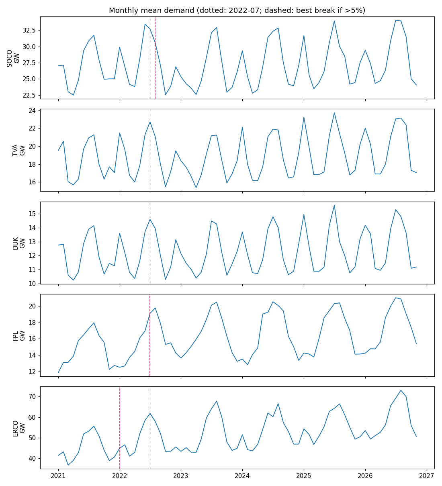
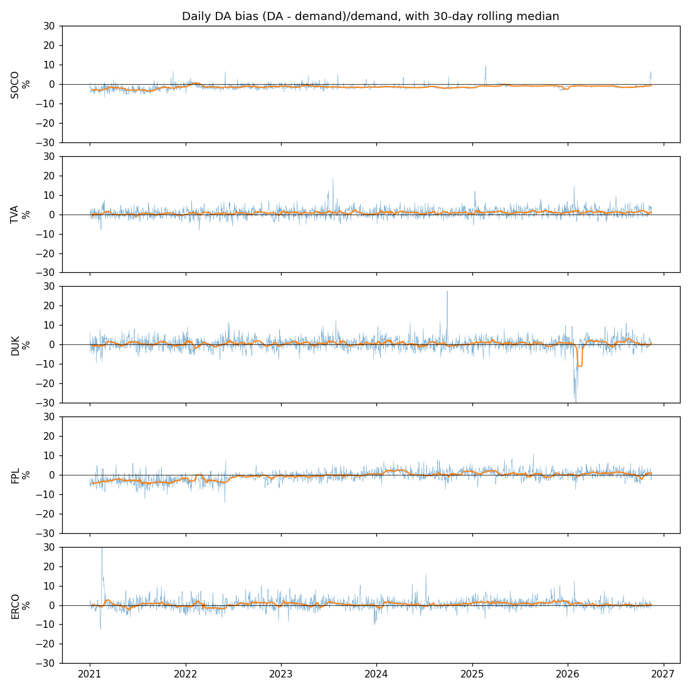
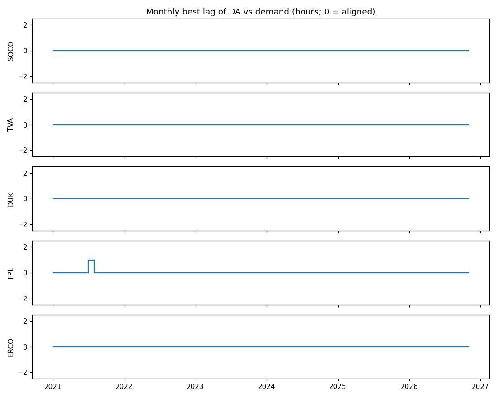

# EIA-930 data-quality audit

Generated by `python -m nowcaster.ingest.audit`. Source: EIA-930 six-month BALANCE files (final, revised values). Window: 2021-01 to the last hour with reported demand. Years are BA-local calendar years.

Rule (plan v2 §4.1): drop a BA if >2% of hours are implausible or |median daily DA bias| >10%; drop or shorten the window if the DA forecast is shifted by an hour against demand. The rule is applied to **EIA-adjusted demand** (the training target). Implausible = demand missing, ≤0, DA/demand outside [0.5, 2], or an isolated spike (robust z > 10 on level vs a 25-h rolling median, or on a reversed first difference). Bias, hour-shift and break checks use adjusted demand with implausible hours removed. A DA lag ≠ 0 is reported only if it beats lag 0 by > 0.01 in correlation of first differences.

## Verdicts

| BA | Verdict | Implausible (adjusted / reported) | Median daily bias (adjusted / reported) | Best break (deseasonalised) | 2022-07 YoY step | Reasons |
|---|---|---|---|---|---|---|
| SOCO | KEEP | 0.00% / 0.01% | -1.40% / -1.40% | 2022-08 -6.5% | -9.2% | — |
| TVA | KEEP | 0.00% / 0.02% | +0.75% / +0.75% | 2023-01 -4.8% | -2.5% | — |
| DUK | KEEP | 0.05% / 0.14% | +0.43% / +0.43% | 2023-08 +3.8% | -0.6% | — |
| FPL | KEEP | 0.07% / 1.48% | -0.43% / -0.46% | 2022-07 +9.8% | +8.5% | — |
| ERCO | KEEP | 0.05% / 0.09% | +0.35% / +0.35% | 2022-01 +9.7% | -4.5% | — |

## Per-BA detail

Columns `missing` … `implausible` are on **reported** demand; `implausible_adj` on adjusted demand. `median_daily_bias` is on cleaned adjusted demand, `_rep` on reported demand with implausible hours removed. `mape_hourly` = median hourly APE, `mean_ape` = mean hourly APE (both on cleaned adjusted demand; not the scorecard's definition).

## SOCO

Last hour with reported demand: 2026-11-18 06:00 UTC.

| year | hours | missing | nonpos | ratio_out | da_missing | imputed | adj_differs | spikes_level | spikes_diff | implausible | implausible_adj | median_daily_bias | median_daily_bias_rep | mape_hourly | mean_ape | best_lag | corr_lag-1 | corr_lag+0 | corr_lag+1 |
|---|---|---|---|---|---|---|---|---|---|---|---|---|---|---|---|---|---|---|---|
| 2021 | 8759 | 0.00% | 0.00% | 0.00% | 0.01% | 0.00% | 0.00% | 0 | 0 | 0.00% | 0.00% | -2.44% | -2.44% | 2.62% | 3.00% | 0 | 0.861 | 0.960 | 0.863 |
| 2022 | 8760 | 0.00% | 0.00% | 0.00% | 0.01% | 0.00% | 0.00% | 0 | 0 | 0.00% | 0.00% | -1.42% | -1.42% | 1.48% | 2.09% | 0 | 0.867 | 0.965 | 0.871 |
| 2023 | 8760 | 0.00% | 0.00% | 0.00% | 0.01% | 0.00% | 0.00% | 0 | 0 | 0.00% | 0.00% | -1.53% | -1.53% | 1.30% | 2.03% | 0 | 0.872 | 0.968 | 0.871 |
| 2024 | 8784 | 0.00% | 0.00% | 0.00% | 0.01% | 0.00% | 0.00% | 0 | 0 | 0.00% | 0.00% | -1.72% | -1.72% | 1.16% | 1.89% | 0 | 0.884 | 0.985 | 0.888 |
| 2025 | 8760 | 0.00% | 0.00% | 0.03% | 0.01% | 0.03% | 0.03% | 3 | 4 | 0.05% | 0.01% | -1.01% | -1.01% | 1.01% | 1.21% | 0 | 0.897 | 0.993 | 0.895 |
| 2026 | 7705 | 0.00% | 0.00% | 0.00% | 0.01% | 0.00% | 0.00% | 0 | 0 | 0.00% | 0.00% | -1.12% | -1.12% | 1.11% | 1.28% | 0 | 0.895 | 0.980 | 0.894 |

Months where DA best lag ≠ 0: none.

EIA-imputed hours: 3; adjusted demand equals the DA forecast in 100% of them.

Spikes / non-positive values in reported demand (4; 3 corrected in the adjusted series). First 15:

- 2025-02-19 03:00 UTC: reported 83,716 MW, adjusted 28,423 MW, DA 28,423 MW
- 2025-02-20 14:00 UTC: reported 92,428 MW, adjusted 40,189 MW, DA 40,189 MW
- 2025-02-21 23:00 UTC: reported 83,085 MW, adjusted 32,161 MW, DA 32,161 MW
- 2025-12-15 18:00 UTC: reported 25,139 MW, adjusted 25,139 MW, DA 34,183 MW

## TVA

Last hour with reported demand: 2026-11-18 06:00 UTC.

| year | hours | missing | nonpos | ratio_out | da_missing | imputed | adj_differs | spikes_level | spikes_diff | implausible | implausible_adj | median_daily_bias | median_daily_bias_rep | mape_hourly | mean_ape | best_lag | corr_lag-1 | corr_lag+0 | corr_lag+1 |
|---|---|---|---|---|---|---|---|---|---|---|---|---|---|---|---|---|---|---|---|
| 2021 | 8759 | 0.00% | 0.01% | 0.01% | 0.00% | 0.01% | 0.01% | 0 | 1 | 0.02% | 0.01% | +0.11% | +0.11% | 1.59% | 2.05% | 0 | 0.858 | 0.962 | 0.859 |
| 2022 | 8760 | 0.00% | 0.01% | 0.00% | 0.24% | 0.01% | 0.01% | 0 | 0 | 0.01% | 0.00% | +0.55% | +0.55% | 1.85% | 2.37% | 0 | 0.871 | 0.968 | 0.867 |
| 2023 | 8760 | 0.00% | 0.00% | 0.00% | 0.00% | 0.00% | 0.00% | 0 | 0 | 0.00% | 0.00% | +0.65% | +0.65% | 1.78% | 2.39% | 0 | 0.870 | 0.964 | 0.860 |
| 2024 | 8784 | 0.00% | 0.00% | 0.01% | 0.00% | 0.01% | 0.01% | 1 | 1 | 0.01% | 0.00% | +0.80% | +0.80% | 1.67% | 2.14% | 0 | 0.884 | 0.972 | 0.875 |
| 2025 | 8760 | 0.00% | 0.00% | 0.00% | 0.00% | 0.00% | 0.00% | 0 | 0 | 0.00% | 0.00% | +1.02% | +1.02% | 1.78% | 2.31% | 0 | 0.875 | 0.968 | 0.872 |
| 2026 | 7705 | 0.00% | 0.04% | 0.06% | 0.00% | 0.09% | 0.09% | 5 | 5 | 0.10% | 0.01% | +1.07% | +1.07% | 1.78% | 2.39% | 0 | 0.891 | 0.967 | 0.881 |

Months where DA best lag ≠ 0: none.

EIA-imputed hours: 10; adjusted demand equals the DA forecast in 100% of them.

Spikes / non-positive values in reported demand (12; 10 corrected in the adjusted series). First 15:

- 2021-08-20 05:00 UTC: reported -9,946,969 MW, adjusted 18,174 MW, DA 18,174 MW
- 2021-11-08 06:00 UTC: reported 1,555 MW, adjusted 1,555 MW, DA 15,497 MW
- 2022-01-31 04:00 UTC: reported -45,117 MW, adjusted 20,558 MW, DA 20,558 MW
- 2024-12-18 15:00 UTC: reported 9,971,121 MW, adjusted 16,915 MW, DA 16,915 MW
- 2026-07-22 05:00 UTC: reported -24,914 MW, adjusted 23,093 MW, DA 23,093 MW
- 2026-07-29 22:00 UTC: reported -89,852 MW, adjusted 29,580 MW, DA 29,580 MW
- 2026-08-04 01:00 UTC: reported 924,880 MW, adjusted 24,823 MW, DA 24,823 MW
- 2026-09-12 02:00 UTC: reported 1,860,402 MW, adjusted 24,549 MW, DA 24,549 MW
- 2026-09-12 04:00 UTC: reported 141,661 MW, adjusted 21,771 MW, DA 21,771 MW
- 2026-10-02 21:00 UTC: reported 989,284 MW, adjusted 25,588 MW, DA 25,588 MW
- 2026-10-13 03:00 UTC: reported -881,044 MW, adjusted 19,246 MW, DA 19,246 MW
- 2026-10-20 23:00 UTC: reported 44,377 MW, adjusted 44,377 MW, DA 17,630 MW

## DUK

Last hour with reported demand: 2026-11-18 05:00 UTC.

| year | hours | missing | nonpos | ratio_out | da_missing | imputed | adj_differs | spikes_level | spikes_diff | implausible | implausible_adj | median_daily_bias | median_daily_bias_rep | mape_hourly | mean_ape | best_lag | corr_lag-1 | corr_lag+0 | corr_lag+1 |
|---|---|---|---|---|---|---|---|---|---|---|---|---|---|---|---|---|---|---|---|
| 2021 | 8759 | 0.00% | 0.00% | 0.00% | 0.01% | 0.00% | 0.00% | 0 | 0 | 0.00% | 0.00% | +0.41% | +0.41% | 2.14% | 2.82% | 0 | 0.841 | 0.957 | 0.861 |
| 2022 | 8760 | 0.00% | 0.00% | 0.00% | 0.00% | 0.00% | 0.00% | 0 | 0 | 0.00% | 0.00% | +0.26% | +0.26% | 2.17% | 2.89% | 0 | 0.844 | 0.956 | 0.870 |
| 2023 | 8760 | 0.00% | 0.00% | 0.00% | 0.00% | 0.00% | 0.00% | 0 | 0 | 0.00% | 0.00% | +0.54% | +0.54% | 1.92% | 2.53% | 0 | 0.859 | 0.970 | 0.868 |
| 2024 | 8784 | 0.00% | 0.00% | 0.00% | 0.00% | 0.00% | 0.00% | 0 | 0 | 0.00% | 0.00% | +0.23% | +0.23% | 2.15% | 2.86% | 0 | 0.871 | 0.971 | 0.871 |
| 2025 | 8760 | 0.29% | 0.00% | 0.00% | 0.29% | 0.27% | 0.00% | 0 | 0 | 0.29% | 0.01% | +0.65% | +0.65% | 1.99% | 2.57% | 0 | 0.872 | 0.971 | 0.873 |
| 2026 | 7705 | 0.32% | 0.00% | 0.31% | 0.32% | 0.31% | 0.00% | 0 | 0 | 0.64% | 0.32% | +0.73% | +0.73% | 2.16% | 3.65% | 0 | 0.888 | 0.965 | 0.888 |

Months where DA best lag ≠ 0: none.

EIA-imputed hours: 48; adjusted demand equals the DA forecast in 0% of them.

Gaps in reported demand of 6+ hours: 2025-11-02 05:00–2025-11-03 05:00 UTC (25 h), 2026-11-01 05:00–2026-11-02 05:00 UTC (25 h).

## FPL

Last hour with reported demand: 2026-11-18 05:00 UTC.

| year | hours | missing | nonpos | ratio_out | da_missing | imputed | adj_differs | spikes_level | spikes_diff | implausible | implausible_adj | median_daily_bias | median_daily_bias_rep | mape_hourly | mean_ape | best_lag | corr_lag-1 | corr_lag+0 | corr_lag+1 |
|---|---|---|---|---|---|---|---|---|---|---|---|---|---|---|---|---|---|---|---|
| 2021 | 8759 | 0.06% | 0.01% | 0.02% | 0.30% | 0.07% | 0.01% | 0 | 1 | 0.10% | 0.03% | -3.25% | -3.28% | 3.64% | 4.28% | 0 | 0.740 | 0.836 | 0.831 |
| 2022 | 8760 | 6.34% | 0.00% | 0.02% | 0.03% | 6.34% | 0.00% | 0 | 1 | 6.36% | 0.02% | -1.27% | -1.42% | 2.69% | 3.29% | 0 | 0.789 | 0.898 | 0.881 |
| 2023 | 8760 | 1.13% | 0.01% | 0.12% | 0.83% | 0.94% | 0.08% | 6 | 1 | 1.26% | 0.32% | -0.40% | -0.43% | 2.70% | 3.12% | 0 | 0.834 | 0.949 | 0.939 |
| 2024 | 8784 | 0.85% | 0.00% | 0.03% | 0.28% | 0.87% | 0.01% | 0 | 3 | 0.89% | 0.02% | +0.94% | +0.97% | 2.84% | 3.30% | 0 | 0.811 | 0.925 | 0.917 |
| 2025 | 8760 | 0.03% | 0.00% | 0.01% | 0.29% | 0.03% | 0.00% | 0 | 1 | 0.05% | 0.01% | +0.34% | +0.34% | 2.73% | 3.18% | 0 | 0.836 | 0.949 | 0.939 |
| 2026 | 7705 | 0.04% | 0.00% | 0.01% | 0.32% | 0.04% | 0.00% | 0 | 1 | 0.05% | 0.01% | +0.55% | +0.55% | 2.60% | 3.09% | 0 | 0.815 | 0.934 | 0.919 |

Months where DA best lag ≠ 0: 2021-07 (+1h).

EIA-imputed hours: 725; adjusted demand equals the DA forecast in 99% of them.

Gaps in reported demand of 6+ hours: 2022-01-26 06:00–2022-02-08 05:00 UTC (312 h), 2022-02-10 06:00–2022-02-20 05:00 UTC (240 h), 2023-07-10 05:00–2023-07-11 04:00 UTC (24 h), 2023-08-21 05:00–2023-08-22 04:00 UTC (24 h), 2023-10-31 05:00–2023-11-02 04:00 UTC (48 h), 2024-05-30 05:00–2024-05-31 04:00 UTC (24 h), 2024-06-24 05:00–2024-06-25 04:00 UTC (24 h), 2024-10-28 05:00–2024-10-29 04:00 UTC (24 h).

Spikes / non-positive values in reported demand (15; 9 corrected in the adjusted series). First 15:

- 2021-01-09 05:00 UTC: reported -6,831 MW, adjusted 9,634 MW, DA 9,634 MW
- 2021-07-25 02:00 UTC: reported 28,552 MW, adjusted 28,552 MW, DA 16,708 MW
- 2022-05-29 03:00 UTC: reported 32,666 MW, adjusted 32,666 MW, DA 15,157 MW
- 2023-02-08 04:00 UTC: reported 67,725 MW, adjusted 12,439 MW, DA 12,439 MW
- 2023-02-08 05:00 UTC: reported 67,327 MW, adjusted 11,187 MW, DA 11,187 MW
- 2023-09-27 04:00 UTC: reported 66,577 MW, adjusted 15,633 MW, DA 15,633 MW
- 2023-11-15 03:00 UTC: reported 72,201 MW, adjusted 15,184 MW, DA 15,184 MW
- 2023-11-15 04:00 UTC: reported 71,967 MW, adjusted 14,053 MW, DA 14,053 MW
- 2023-11-15 05:00 UTC: reported 71,779 MW, adjusted 12,871 MW, DA 12,871 MW
- 2023-11-17 05:00 UTC: reported -22 MW, adjusted 11,862 MW, DA 11,862 MW
- 2024-02-01 05:00 UTC: reported 32,218 MW, adjusted 32,218 MW, DA 11,138 MW
- 2024-03-10 00:00 UTC: reported 39 MW, adjusted 39 MW, DA 19,467 MW
- 2024-08-31 04:00 UTC: reported 42,333 MW, adjusted 16,805 MW, DA 16,805 MW
- 2025-04-27 14:00 UTC: reported 2,259 MW, adjusted 2,259 MW, DA 15,831 MW
- 2026-09-12 04:00 UTC: reported 666 MW, adjusted 666 MW, DA 17,646 MW

## ERCO

Last hour with reported demand: 2026-11-18 06:00 UTC.

| year | hours | missing | nonpos | ratio_out | da_missing | imputed | adj_differs | spikes_level | spikes_diff | implausible | implausible_adj | median_daily_bias | median_daily_bias_rep | mape_hourly | mean_ape | best_lag | corr_lag-1 | corr_lag+0 | corr_lag+1 |
|---|---|---|---|---|---|---|---|---|---|---|---|---|---|---|---|---|---|---|---|
| 2021 | 8759 | 0.00% | 0.00% | 0.00% | 0.00% | 0.00% | 0.00% | 0 | 0 | 0.00% | 0.00% | -0.01% | -0.01% | 1.78% | 2.88% | 0 | 0.875 | 0.962 | 0.877 |
| 2022 | 8760 | 0.00% | 0.00% | 0.00% | 0.00% | 0.00% | 0.00% | 0 | 0 | 0.00% | 0.00% | +0.16% | +0.16% | 2.14% | 2.79% | 0 | 0.891 | 0.973 | 0.888 |
| 2023 | 8760 | 0.00% | 0.00% | 0.00% | 0.00% | 0.00% | 0.00% | 0 | 0 | 0.00% | 0.00% | +0.34% | +0.34% | 1.99% | 2.60% | 0 | 0.890 | 0.971 | 0.893 |
| 2024 | 8784 | 0.00% | 0.00% | 0.00% | 0.00% | 0.00% | 0.00% | 0 | 0 | 0.00% | 0.00% | +0.32% | +0.32% | 1.61% | 2.16% | 0 | 0.886 | 0.963 | 0.877 |
| 2025 | 8760 | 0.55% | 0.00% | 0.00% | 0.55% | 0.27% | 0.00% | 0 | 0 | 0.55% | 0.27% | +1.07% | +1.08% | 1.88% | 2.45% | 0 | 0.862 | 0.951 | 0.879 |
| 2026 | 7705 | 0.00% | 0.00% | 0.00% | 0.00% | 0.00% | 0.00% | 0 | 0 | 0.00% | 0.00% | +0.08% | +0.08% | 1.31% | 1.73% | 0 | 0.902 | 0.976 | 0.903 |

Months where DA best lag ≠ 0: none.

EIA-imputed hours: 24; adjusted demand equals the DA forecast in 100% of them.

Gaps in reported demand of 6+ hours: 2025-12-04 07:00–2025-12-06 06:00 UTC (48 h).

## Implications for modelling

- **Imputed hours carry DA as demand.** Where EIA imputes demand, the adjusted value is the DA forecast, so the residual-on-DA target is exactly zero there. Exclude `demand_imputed` hours from training targets and scoring (M3 would otherwise learn spurious zero corrections).
- **Adjusted demand still has a few bad hours** (see spike lists where adjusted = reported). Use `demand_clean` logic (adjusted with implausible hours removed) for targets.
- **Reported demand has extreme spikes** (TVA ±9.9 GW-scale typos, FPL 60–70 GW). Live lag features need a plausibility filter before use.
- **SOCO and FPL step in mid-2022** (Gulf Power load moving from SOCO to FPL): the long-history (2022+) temperature-only variant should start after 2022-08 for these two, or include a level dummy. The 2024+ modelling window is unaffected.
- **DUK/FPL whole-day gaps** on several days, including DUK on both DST fall-back days in the window. Rows exist but demand is blank (adjusted is imputed).

Notes:

- `adj_differs` is the share of hours where EIA-adjusted demand differs from reported demand.
- These are final values. First-reported (live) values differ; see plan v2 §7.2. Spikes that survive in *reported* demand mean the live pipeline needs its own implausibility filter on lag features (the API may serve reported, not adjusted, values).
- The 2022-07 YoY step compares the 6 months after vs before July 2022, each against the same months a year earlier; weather moves it by several percent, so read it with the plot.